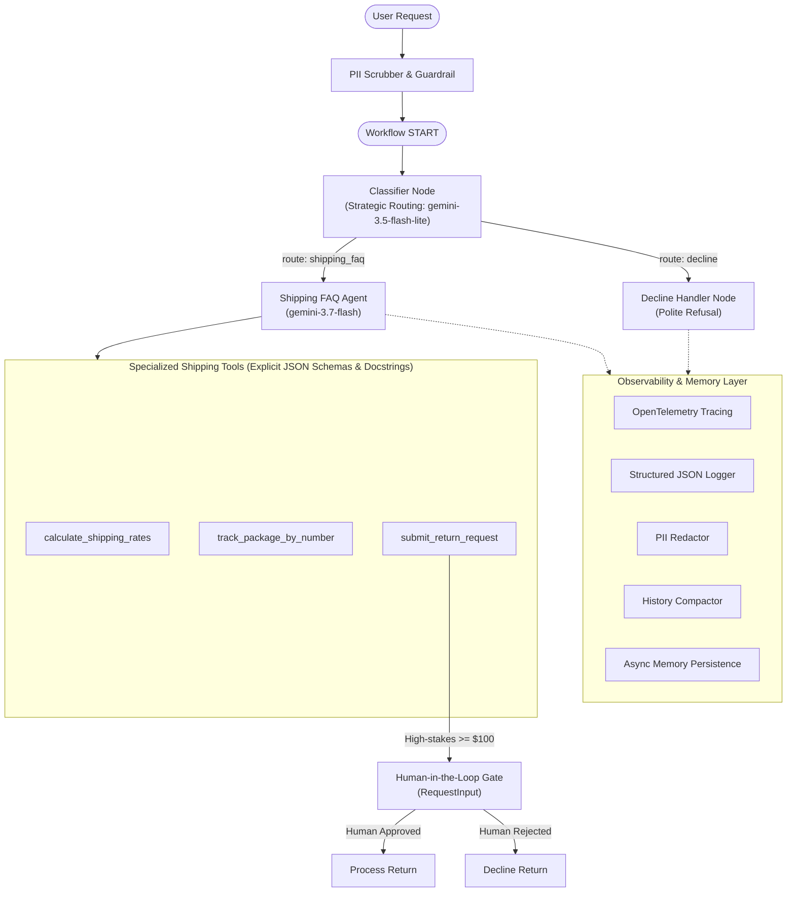
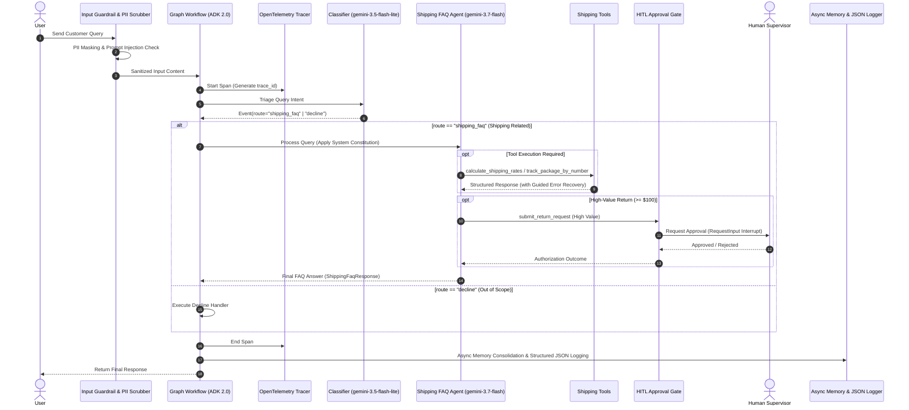

# Customer Support Agent - Architecture & Design Document

## 1. Overview

This project (`customer-support-agent`) is an enterprise-grade customer support agent built for a shipping and logistics company using **Google ADK 2.0 (Agent Development Kit)** Graph Workflows.
It provides multi-layered query classification, input guardrails, domain-specialized tools, Human-in-the-Loop (HITL) approval workflows, and polite decline routing for out-of-domain inquiries. The runtime environment is built on **Python 3.13**.

## 2. System Architecture

## 3. Sequence Diagram

## 4. Component Details

### 4.1 Input Guardrails & PII Scrubber (`guardrails.py`)
- Regular expression redaction for credit cards, email addresses, phone numbers, and Social Security Numbers (SSNs).
- Detects and blocks prompt injection and system instruction override attacks.

### 4.2 Classifier Node (`classifier.py`)
- Evaluates user input messages and emits routing events (`route="shipping_faq"` or `route="decline"`).
- Shipping topics supported: Rates, Tracking, Delivery scheduling, and Returns.

### 4.3 Shipping FAQ Agent & Tools (`shipping_faq.py`, `tools.py`)
- Built with `LlmAgent` powered by `gemini-3.7-flash` and guided by the system constitution (`prompts.py`).
- Tools:
  - `calculate_shipping_rates`: Calculates estimated cost and delivery timeframe based on ZIP codes and weight.
  - `track_package_by_number`: Queries tracking database for shipment milestone, location, and ETA.
  - `submit_return_request`: Registers return requests with guided recovery instructions.

### 4.4 Human-in-the-Loop Gate (`hitl.py`)
- Emits `RequestInput` interrupts for return requests exceeding the $100 threshold, requiring explicit human supervisor authorization.

### 4.5 Observability & Memory (`observability.py`, `memory.py`)
- Distributed tracing using OpenTelemetry (`trace_id` and `span_id` propagation).
- Structured JSON logger recording execution intent before tool execution and outcome afterward.
- Sliding-window context compaction preventing token explosion in long conversation turns.
- SQLite-backed session persistence with non-blocking asynchronous memory consolidation.

## 5. Security & Authentication (Vertex AI ADC)

The system leverages Google Cloud Vertex AI Application Default Credentials (ADC), eliminating hardcoded API keys. It also supports secure configuration retrieval via Google Cloud Secret Manager.
